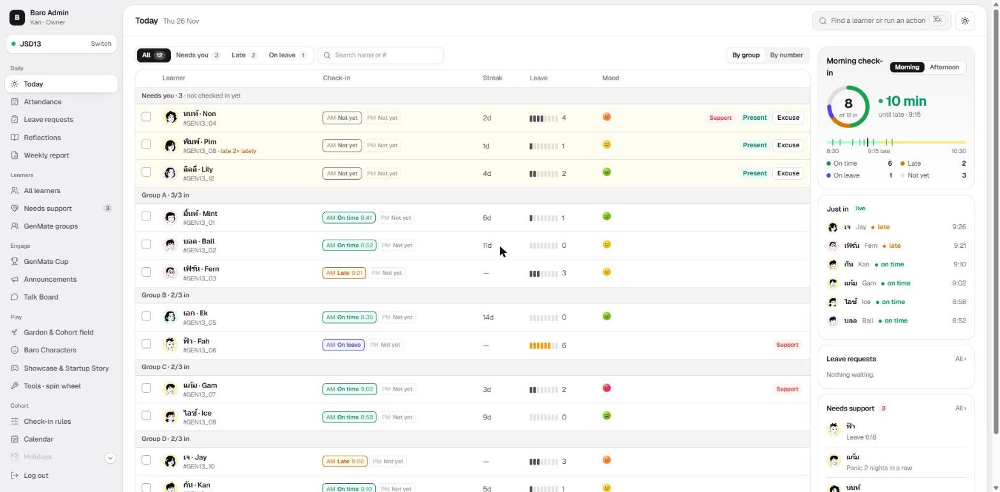
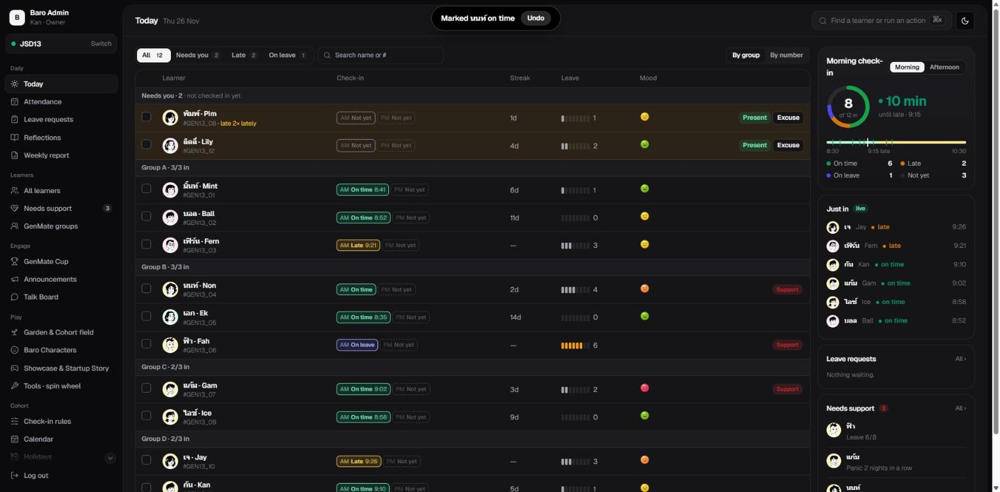
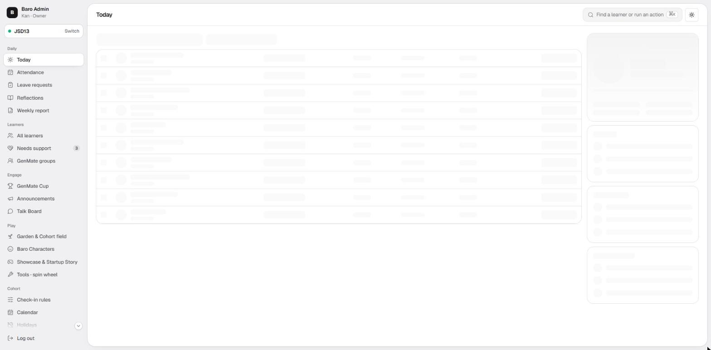
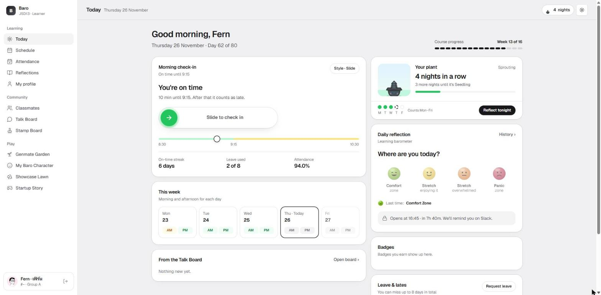
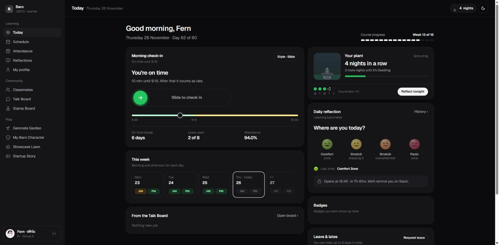

# Baro Frontend

React frontend for Baro, the daily reflection and attendance app for Generation Thailand's bootcamp cohorts. Learners check in, write a nightly reflection and keep a streak; staff run the day from an admin board.

## Screenshots

All screenshots use made-up learners and data.

**Admin · Today**: the live check-in board. Who still needs a check-in is pinned on top; the side rail shows the session countdown, who just checked in, leave requests and who needs support.



**Marks show instantly.** Quick *Present* / *Excuse* updates the row before the server answers (and rolls back if the save fails). Toasts are a single "dynamic island" capsule across the app.



**Loading looks like the page.** Every admin and learner page has a skeleton shaped like its real layout, plus a "still loading" hint after a few seconds.



**Learner · Today**: check in with a slide, see the week, the plant streak and the nightly reflection.





## Prerequisites

- Node.js 18+
- npm
- The Baro backend (`baro-gofiber`) running locally, or a reachable deployment

## Installation

```bash
cd react-genbaro
npm install
```

## Environment Variables

The app always calls the API under `/api` on its own origin, so the session cookie stays first-party:

- **Production (Vercel):** `vercel.json` rewrites `/api/*` to the backend.
- **Development (Vite):** the dev server proxies `/api/*` to the backend.

| Variable | Used by | Description | Default |
|----------|---------|-------------|---------|
| `VITE_API_PROXY` | `vite.config.ts` (dev only) | Where the dev server forwards `/api` | `http://127.0.0.1:3000` |

## Running the App

```bash
npm run dev        # dev server on :5173
npm run build      # production build to dist/
npm run preview    # preview the production build
```

## Available Scripts

| Script | Description |
|--------|-------------|
| `npm run dev` | Start the development server |
| `npm run build` | Type check, then build for production (Vercel runs this, so a type error blocks the deploy) |
| `npm run typecheck` | `tsc -b`, no emit |
| `npm run lint` | ESLint |
| `npm run test` | Vitest in watch mode |
| `npx vitest run <path>` | Run one test file once |
| `npm run test:coverage` | Vitest with coverage |
| `npm run test:ui` | Vitest UI |

## Tech Stack

- **Framework**: React 18 + Vite
- **Language**: TypeScript (strict)
- **UI**: shadcn/ui, Tailwind CSS, Radix UI primitives
- **Data**: React Query v3, Axios
- **Toasts**: sonner, styled as a top-center "island" (`components/IslandToaster.tsx`)
- **Routing**: React Router DOM v7
- **3D garden**: @react-three/fiber + drei
- **Tests**: Vitest, Testing Library, MSW

## Project Structure

```
src/
├── admin/                 # Staff app: Today, attendance, learners, support, reflections, cup, Slack…
│   ├── today/             # Live check-in board (Roster, SessionCard, side rail)
│   ├── learner/           # Learner side panel + mark-with-undo
│   └── ui/                # Admin-only bits (LeaveMeter, Confirm, status colors)
├── learner/               # Learner app: Today, check-in, reflections, attendance, classmates, board, profile
├── application/
│   ├── contexts/          # AuthContext, UserDataContext
│   ├── hooks/             # React Query hooks
│   └── services/          # One file per API resource
├── domain/types/          # Shared API types
├── infrastructure/        # Axios client, cookie/storage helpers
├── components/            # Shared components (IslandToaster, LoadingSkeleton, garden/farm, ui/)
├── lib/                   # queryClient, api barrel, farm/garden helpers
├── routes/layouts/        # AdminLayout, LearnerLayout, AuthedPageLayout
├── utils/                 # date-utils (Thailand time) and friends
└── main.tsx
```

## Loading, Caching and Feedback

- **Skeletons** come from `components/LoadingSkeleton.tsx`. `Bone` is a single block, `SkeletonRows` gives table rows, and `LoadingHint` is a screen-reader status that shows a "still loading" line after 4 s. Each page or card keeps its skeleton next to the real component (e.g. `WeekCardSkeleton` in `WeekCard.tsx`), so the two stay in step.
- **Query cache**: React Query defaults to `staleTime: 30s` and `retry: 1` (`lib/queryClient.ts`). The live check-in screens (admin Today, learner Today) opt out with `staleTime: 0` and refetch on their own interval. Every mutation invalidates the queries it affects.
- **Optimistic marks**: `admin/learner/useMarkWithUndo.ts` writes the new status into the cached Today board immediately, refetches after the save, and restores the board if the save fails. Each success toast carries an **Undo**.
- **Toasts**: one library (sonner) app-wide. `IslandToaster` renders a black capsule that opens out of a small pill, stacks up to three, fades instead under `prefers-reduced-motion`, and stays centered on phones.

## Routing

Role-based nested layouts. Signup lives at an obscured path; there is no self-serve registration.

| Route | Area | Access |
|-------|------|--------|
| `/login` | Login | Public |
| `/learner/*` | Learner app (Today, reflections, attendance, schedule, classmates, board, profile, garden) | Learner |
| `/admin/*` | Staff app (Today, attendance, learners, support, reflections, cohort settings…) | Admin |
| `/profile/:id`, `/talk-board`, `/stamp-board`, `/tools`, … | Shared pages | Learner + Admin |

## Testing

```bash
npm run test                         # watch mode
npx vitest run src/admin/today       # one folder, once
npm run test:coverage
```

Run `npm run typecheck && npx vitest run && npm run build` before opening a PR.

## License

ISC
